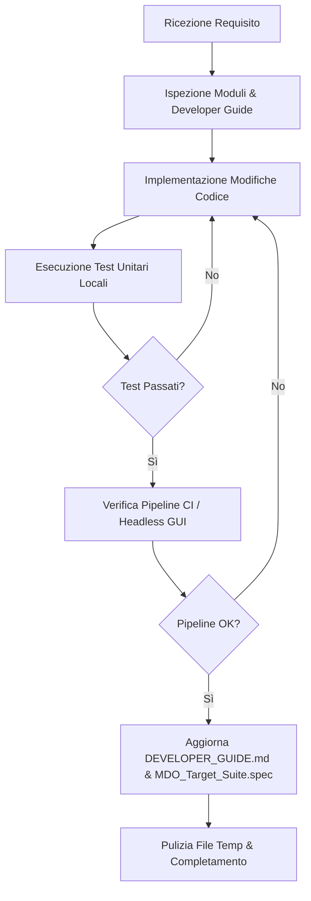

# Dynamic Target Suite — Gemini Operating & Architecture Manual (GEMINI.md)

Questo file definisce le linee guida operative, gli standard architetturali e i protocolli di pulizia e manutenzione per **Google Gemini** e gli sviluppatori che collaborano al repository **Dynamic Target Suite**.

L'obiettivo primario è mantenere il progetto **pulito, modulare, rigoroso dal punto di vista matematico, performante e facilmente comprensibile**.

---

## 1. Visione del Progetto & Ambito Fisico

**Dynamic Target Suite** è un ambiente integrato per Formula SAE / Formula Student e prototipi da corsa ad alte prestazioni, dedicato all'analisi di dinamica del veicolo, ottimizzazione multidisciplinare (**MDO**) e simulazione interattiva real-time.

Il software copre l'intero ciclo di setup veicolo:
$$\text{Parametri Geometrici/Fisici} \longrightarrow \text{Ottimizzazione (MDO/Trim)} \longrightarrow \text{Handling & DNA Maps} \longrightarrow \text{Validazione Transitoria} \longrightarrow \text{Simulatore Real-Time}$$

---

## 2. Struttura del Repository e Tassonomia dei File

Per mantenere il progetto ordinato ed evitare proliferazione di file sparsi, ogni componente risiede in uno spazio ben definito:

```
Dynamic_Target_Suite/
│
├── main.py                             # Entrypoint principale dell'applicazione
├── requirements.txt                    # Dipendenze Python
├── pytest.ini                          # Configurazione runner test
├── build_exe.bat                       # Script di compilazione PyInstaller
├── MDO_Target_Suite.spec               # Specfile PyInstaller
├── README.md & LICENSE                 # Documentazione di primo livello e licenza
│
├── src/                                # Package sorgente principale
│   ├── models/                         # [MODELLI FISICI, PNEUMATICI & PARAMETRI]
│   │   ├── params_vehicle.py           # SINGLE SOURCE OF TRUTH: Dataclass VehicleParams & catalogo setup
│   │   ├── params_tire.py              # Parser file .TIR (Pacejka MF6.1)
│   │   ├── tire_model_mf61.py          # Modello pneumatico non-lineare MF6.1 simbolico/vettoriale
│   │   ├── tire_degradation.py         # Modello termico/degradazione battistrada
│   │   ├── vehicle_3dof.py             # Modello 3-DOF Steady-State (CasADi Newton trim)
│   │   ├── vehicle_7dof.py             # Modello 7-DOF Transitorio (imbardata, rollio, 4 ruote)
│   │   ├── vehicle_14dof.py            # Modello 14-DOF Full Vehicle (sospensioni 3D, cinematica, bump stop)
│   │   ├── damper_model_ttx25.py       # Modello ammortizzatori Öhlins TTX25 MkII
│   │   ├── powertrain_electric.py      # Motore EMRAX 188HV, mappe efficienza & TV
│   │   ├── steering_dynamics.py        # Sforzo al volante e bracci a terra
│   │   └── vehicle_3d_models.py        # Mesh geometriche 3D telaio e ruote
│   │
│   ├── mdo/                            # [MDO & SOLUTORI NUMERICI]
│   │   ├── mdo_global_optimizer.py     # Ottimizzatore SLSQP multi-start & derivate di stabilità
│   │   ├── mdo_target_optimization.py  # Handling Diagram, MAPs, Yaw Moment Diagram (YMD)
│   │   ├── mdo_direct_collocation.py   # Traiettoria ottima CasADi + IPOPT in coordinate curvilinee
│   │   ├── mdo_dynamic_events.py       # Simulazione eventi (Step Steer, DLC, Slalom, Endurance)
│   │   ├── mdo_skidpad.py              # Solutore Skidpad stazionario e transitorio
│   │   ├── mdo_acceleration.py         # Simulatore accelerazione longitudinale pura
│   │   ├── mdo_balance_range.py        # Analisi finestre di bilanciamento
│   │   ├── mdo_arb_diamond_balance.py  # Mappa Diamond barre antirollio
│   │   ├── mdo_seven_post_rig.py       # Core fisico 7-Post Rig shaker
│   │   ├── mdo_sensitivity.py          # Analisi sensitività globale
│   │   ├── mdo_uncertainty.py          # Propagazione incertezze
│   │   └── mdo_steady_state.py         # Valutazione KPI stazionari
│   │
│   ├── core/                           # [CORE ENGINE, EQUILIBRIO & SIMULAZIONE]
│   │   ├── simulator.py                # Wrapper unificato di simulazione
│   │   ├── om_vehicle_equilibrium.py   # Componente OpenMDAO equilibrio veicolo
│   │   ├── road_profile.py             # Generatore profili stradali (PSD, bump, sintetici)
│   │   ├── simulation_options.py       # Opzioni e tolleranze di simulazione
│   │   ├── gamepad_manager.py          # Gestione input controller e volanti FFB
│   │   ├── physics_thread.py           # Thread real-time physics a 250-500 Hz
│   │   └── vehicle_sim_controller.py   # Controller di simulazione interattivo
│   │
│   ├── ui/                             # [INTERFACCIA GRAFICA & SIMULATORE]
│   │   ├── main_gui.py                 # Entry point interfaccia grafica
│   │   ├── main_gui_pro.py             # UI Moderna: 5 Workspace, zero emoji, docking pulito
│   │   ├── main_gui_classic.py         # UI di riserva/backup classica
│   │   ├── interactive_driver_14dof.py # Simulatore di guida interattivo (OpenGL/PyQt5)
│   │   ├── gui_canvas.py               # Canvas Matplotlib riutilizzabile per PyQt5
│   │   ├── gui_dialogs.py              # Finestre modali e dialoghi di supporto
│   │   ├── gui_workers.py              # Worker QThread asincroni per calcolo non bloccante
│   │   ├── ui_theme_engine.py          # Gestore temi QSS e stile grafici
│   │   ├── ui_seven_post_rig.py        # UI Workspace per 7-Post Rig
│   │   └── legacy/                     # Re-export per compatibilità retroattiva
│   │
│   └── utils/                          # [TOOLSET DI SETUP & UTILITY]
│       ├── track_manager.py            # Gestore tracciati e superficie stradale 2D/3D
│       ├── curve_digitizer.py          # Tool estrazione curve camber/toe da immagini
│       ├── vehicle_dna_maps.py         # Mappe del DNA del Veicolo n1..n6 & Stabilità Modale
│       ├── optimized_params_manager.py # Gestore persistenza parametri ottimizzati
│       ├── suspension_sizing.py        # Dimensionamento molle, barre ARB e Radar 4-Rapporti
│       ├── transient_sensitivity.py    # Sweep 1D/2D con estrazione 21 KPI dinamici
│       └── logger.py                   # Logging strutturato
│
├── data/                               # [DATI, TRACCIATI E CONFIGURAZIONI]
│   ├── tire_tir/                       # File .tir ufficiali Pacejka MF6.1
│   ├── tire_datas/                     # Dati sperimentali banco pneumatici
│   ├── tracks/                         # Coordinate tracciati (.csv, .mat)
│   ├── setups/                         # Setup veicolo esportati (.json)
│   ├── motor_curve/                    # Curve caratteristiche motore
│   └── design_suspension/              # Rilievi cinematici sospensioni
│
├── docs/                               # [DOCUMENTAZIONE TECNICA]
│   ├── DEVELOPER_GUIDE.md              # Architettura approfondita e formule LaTeX
│   ├── md_equations/                   # Note matematiche di dettaglio
│   ├── Mathematica_Reference/          # Riferimenti analitici
│   └── documents/                      # Paper e documentazione tecnica
│
├── tests/                              # [SUITE TEST UNITARI & INTEGRAZIONE]
│   ├── test_*.py                       # Test unitari conformi a unittest/pytest
│   └── ...
│
├── scripts/                            # [AUTOMAZIONE & PIPELINE CI]
│   ├── ci_pipeline.py                  # Script unificato CI (Test + Headless GUI + Build)
│   └── ...
│
└── [RUNTIMES & CACHE - IGNORATI DA GIT]
    ├── .cache/c_build/                 # DLL compilate C/CasADi (`ode_14dof_*.dll`)
    ├── runs/                           # Output simulazioni e log OpenMDAO
    └── venv/                           # Ambiente virtuale locale
```

---

## 3. Regole Fondamentali di Progettazione & Codice Pulito

Per preservare l'integrità e la chiarezza del progetto, ogni modifica deve aderire rigidamente ai seguenti principi:

### 3.1 Single Source of Truth (SSOT)
- Tutte le proprietà fisiche e geometriche del veicolo devono risiedere nella dataclass `VehicleParams` in [`params_vehicle.py`](file:///c:/Users/light/Documents/Università/E18/Dynamic_Target_Suite/params_vehicle.py).
- **Divieto assoluto** di cablare (hardcode) parametri geometrici (passo, carreggiate, masse, altezze baricentro) all'interno dei file di calcolo o delle interfacce.
- Ogni modulo riceve l'istanza `VehicleParams` come argomento o ne istanzia una nominale tramite `nominal_fsae_params()`.

### 3.2 Standard Matematici e Convenzioni di Segno
- **Convenzione di Segno Gradiente di Sottosterzo (Fondamentale)**:  
  Il gradiente delle mappe stazionarie è:
  $$\rho_y = -\frac{K}{L}$$
  da cui discende il gradiente di sottosterzo:
  $$K = -L\,\rho_y$$
  e la condizione necessaria di stabilità stazionaria:
  $$\rho_y < \frac{1}{u^2}$$
  *(Conforme agli standard SAE J670e e ISO 4138)*. Non invertire mai i segni di $\rho_y$ o $K$.
- **Convenzione di Equilibrio Statico a 1g**:  
  Nel modello 14-DOF (`vehicle_14dof.py`), la condizione di terraferma statica con pilota a bordo corrisponde a $z_i = 0\text{ mm}$ su tutte e quattro le ruote. Gli assetti nominali (ride height, camber nominale $\gamma_0$, convergenza $\delta_{toe,0}$) sono calibrati su questa condizione.
- **Formulazione Simbolica CasADi**:  
  I modelli numerici e il modello di pneumatico [`tire_model_mf61.py`](file:///c:/Users/light/Documents/Università/E18/Dynamic_Target_Suite/tire_model_mf61.py) devono essere sempre compatibili con i tipi simbolici CasADi (`SX`, `MX`). Non usare `if/else` standard di Python su variabili simboliche; utilizzare approssimazioni lisce (es. `casadi.tanh`, `casadi.fmax`, regolarizzazioni $\sqrt{x^2 + \epsilon^2}$).

### 3.3 UI Asincrona e Concorrenza
- Nessun calcolo computazionalmente oneroso (ottimizzazioni SLSQP, integrazioni ODE RK4, direct collocation, sweep parametrici) deve essere eseguito nel thread principale della GUI.
- Utilizzare sempre pattern basati su `QThread` definiti in [`gui_workers.py`](file:///c:/Users/light/Documents/Università/E18/Dynamic_Target_Suite/gui_workers.py) con segnali di progresso (`pyqtSignal(int, str)`), completamento (`finished`) ed errore (`error`).

### 3.4 Chiarezza e Manutenibilità del Codice
- **Tipizzazione e Docstring**: Ogni funzione pubblica deve avere type hints completi (`typing.Optional`, `Tuple`, `Dict`, `Union`) e docstring in formato chiaro con unità di misura esplicite nel SI ($[m], [s], [rad], [N], [N/rad], [kg\cdot m^2]$).
- **Design Modulare**: Evitare file monolitici o funzioni con più di 150-200 righe. Suddividere logica matematica, gestione dati e plotting in funzioni distinte.

---

## 4. Ambiente di Esecuzione & Dipendenze

- **Interprete Obbligatorio**:
  ```powershell
  .\venv\Scripts\python.exe
  ```
  *Non usare mai l'interprete globale, onde evitare incompatibilità di binari C (CasADi / SciPy / PyQt5).*

- **Verifica dell'Ambiente**:
  ```powershell
  .\venv\Scripts\python.exe scripts/check_env.py
  ```

- **Dipendenze Chiave**:
  - `casadi` (differenziazione automatica, interfacce IPOPT/MUMPS)
  - `openmdao` (ottimizzazione multidisciplinare)
  - `pyqt5` (GUI desktop ad alte prestazioni)
  - `matplotlib` (rendering grafici vettoriali e interattivi)
  - `scipy`, `numpy`, `pandas` (calcolo scientifico e gestione matriciale)
  - `pygame` (interfaccia gamepad DirectInput/XInput a bassa latenza)
  - `pyinstaller` (compilazione standalone)

---

## 5. Protocollo di Igiene e Pulizia del Workspace

Per mantenere il workspace ordinato e privo di file spazzatura:

1. **Mai salvare file temporanei nella root**:
   - Qualsiasi script di test "usa e getta" va salvato nella cartella [`scratch/`](file:///c:/Users/light/Documents/Università/E18/Dynamic_Target_Suite/scratch).
   - Eventuali log di debug devono essere scritti in file già ignorati da git (`*.log`, `crash_log.txt`).
2. **Directory generate da rimuovere periodicamente**:
   - Directory di log OpenMDAO: `__main__*_out/`, `problem_out/`.
   - Cache Python: `__pycache__/`, `.pytest_cache/`.
   - Build temporanee: `build/`.
3. **Controllo del `.gitignore`**:
   - Assicurarsi sempre che i file di stato utente locali (`ui_settings.json`, `simulation_options.json`, `last_optimized_params.json`) non vengano inclusi nei commit di codice se contengono solo modifiche transitorie di sessione.

---

## 6. Procedura di Modifica e Verifica (Workflow Gemini)

Quando viene richiesta una modifica o una nuova funzionalità, l'agente Gemini deve seguire questo workflow:



### Comandi di Verifica:
1. **Esecuzione rapida suite unit test**:
   ```powershell
   .\venv\Scripts\python.exe -m unittest discover -s tests -p "test_*.py"
   ```
2. **Esecuzione pipeline unificata (Test + GUI headless + Health check)**:
   ```powershell
   .\venv\Scripts\python.exe scripts/ci_pipeline.py
   ```
3. **Aggiornamento Specfile e Compilazione PyInstaller (se aggiunti moduli o asset)**:
   - Se viene creato un nuovo modulo `.py`, aggiungerlo alla lista `hiddenimports` in [`MDO_Target_Suite.spec`](file:///c:/Users/light/Documents/Università/E18/Dynamic_Target_Suite/MDO_Target_Suite.spec).
   - Testare la compilazione standalone:
     ```powershell
     .\venv\Scripts\pyinstaller.exe --noconfirm MDO_Target_Suite.spec
     ```

---

## 7. Documentazione Sincronizzata

Ogni modifica strutturale deve riflettersi nei documenti di riferimento:
- [`docs/DEVELOPER_GUIDE.md`](file:///c:/Users/light/Documents/Università/E18/Dynamic_Target_Suite/docs/DEVELOPER_GUIDE.md): Architettura approfondita, modelli fisici, formule LaTeX e diagrammi di flusso.
- [`CHANGELOG.md`](file:///c:/Users/light/Documents/Università/E18/Dynamic_Target_Suite/CHANGELOG.md): Registro sintetico delle modifiche, correzioni di bug e nuove feature con tag di versione.
- [`README.md`](file:///c:/Users/light/Documents/Università/E18/Dynamic_Target_Suite/README.md): Documento di primo livello con quickstart e screenshot (mantenere aggiornate le tabelle dei parametri nominali se cambiano).
